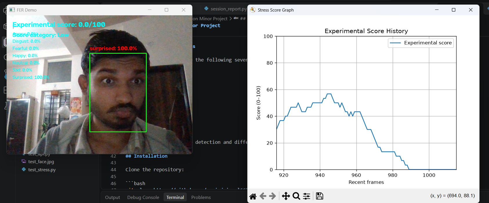
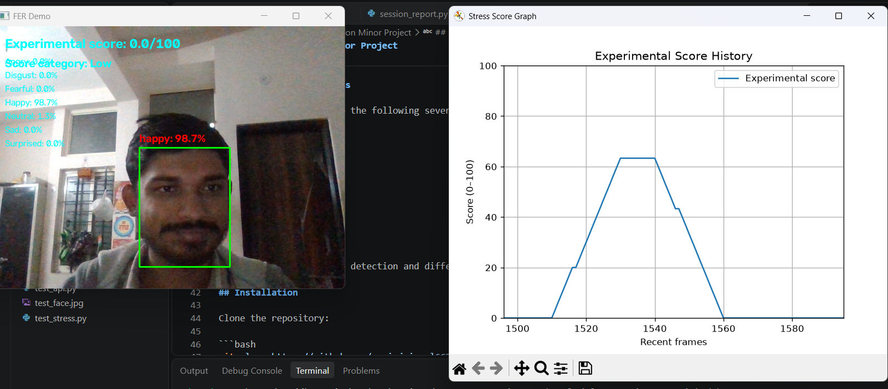
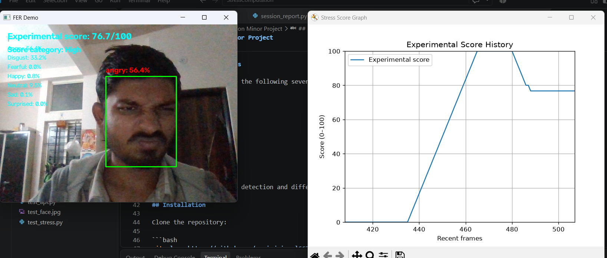
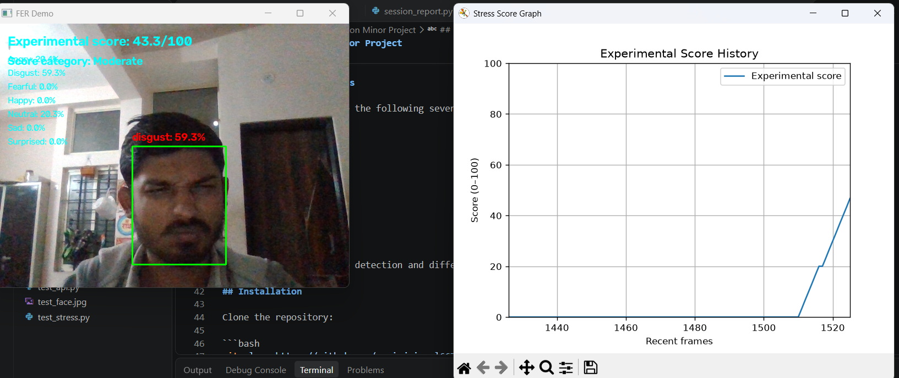
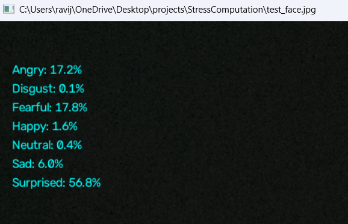

# Stress Computation Minor Project

This project is developed to detect and recognize human facial expressions using a webcam or an image.

The system first detects a person's face and then identifies the facial expression. It can recognize seven different expressions and display their corresponding probabilities on the screen.

## Features

- Detects faces using a webcam.
- Recognizes seven different facial expressions.
- Supports both image and live camera input.
- Displays the detected facial expression with probabilities.
- Performs real-time facial expression recognition.

## Technologies Used
- Python
- OpenCV
- ONNX Runtime

## Models Used

1. **YuNet:** Used for face detection.
2. **MobileFaceNet:** Used for facial expression recognition.

## Recognized Expressions

The system can recognize the following seven expressions:

- Happy
- Sad
- Angry
- Neutral
- Surprise
- Fear
- Disgust

## Project Screenshots

### Surprised Expression


### Happy Expression


### Angry Expression


### Disgust Expression


### Static Image Output (test_face.jpg)


## Installation

Clone the repository:

```bash
git clone https://github.com/ravi-jaiswal667/Stress-Computation-Minor-Project.git
```

Go inside the project folder:
cd Stress-Computation-Minor-Project


Create a virtual environment:

```bash
python -m venv venv
```

Activate  virtual environment:
```bash
venv\Scripts\activate
```

Install the packages:
pip install -r requirements.txt

## How to Run
## To run webcam facial expressions use below command in your terminal:-
python facial_expression_recognition\demo.py

## To run static image based facial expression recognition(test_face.jpg) file in our case , Run below commands:-
python facial_expression_recognition\demo.py --input 
"C:\Users\ravij\OneDrive\Desktop\projects\StressComputation\test_face.jpg" --vis


## Note

This project is currently showing averages/probabilities of expression, Later I will use this expressions to show an individual stress
using the last 30 to 50 frames and requires data validation if any on my Frontend.